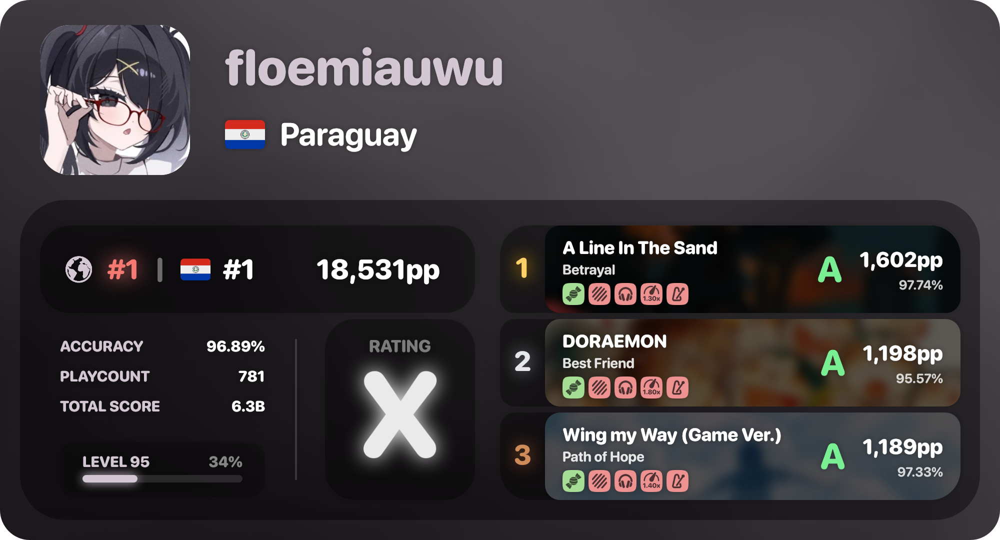
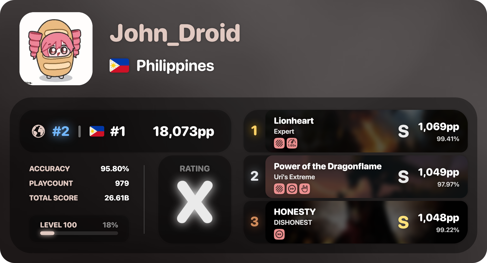
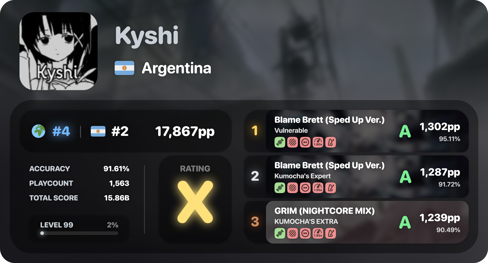
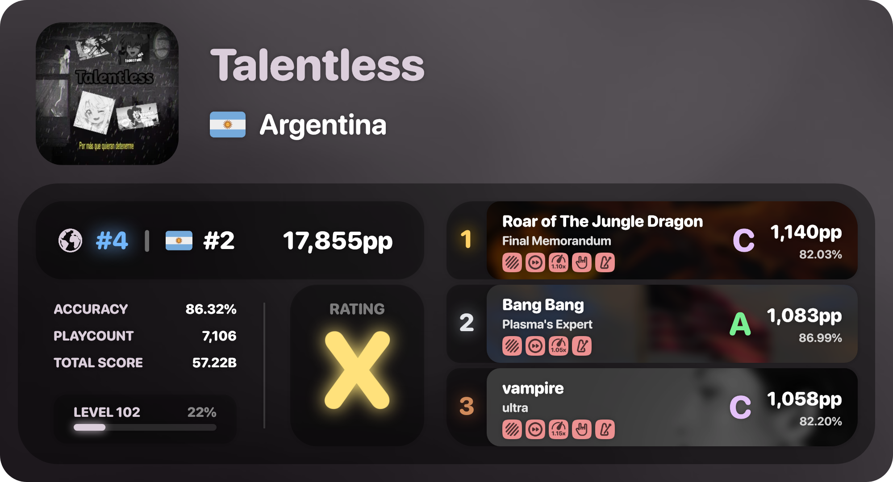
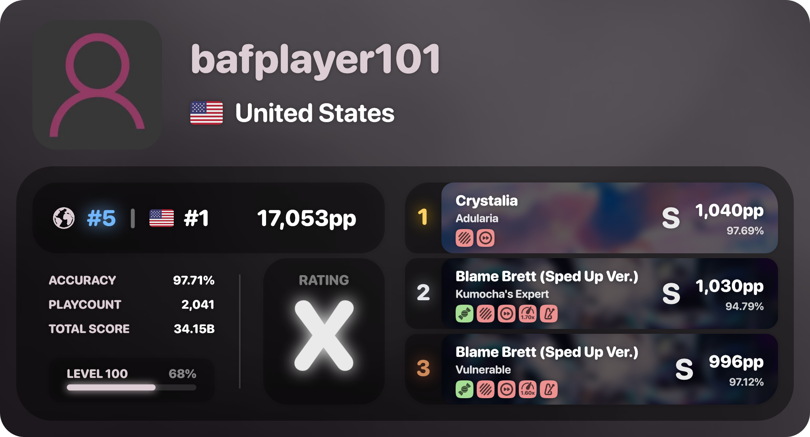

# osu-droid-card

generate a profile card from an osu!droid user with the help of [@floemia/osu-droid-tools](../osu-droid-tools/)!

## requirements

- an osu!api v1 key. request one [here](https://osu.ppy.sh/home/account/edit#legacy-api). the requested beatmaps are cached internally to avoid unnecesary requests.

## installation

```bash
npm install @floemia/osu-droid-card
```

## usage

```ts
import { DroidCard } from '@floemia/osu-droid-card';
import { OsuAPIRequestBuilder } from '@rian8337/osu-base';
import 'dotenv/config';
import { writeFileSync } from 'node:fs';

// set your api key
OsuAPIRequestBuilder.setAPIKey(process.env.OSU_API_KEY);

// .create() accepts number (uid) | string (username) | DroidUser
const user = 177955 || 'floemiauwu' || (await DroidUser.get(177955));
const buffer = await DroidCard.create(user);

writeFileSync(`${user.id}.png`, buffer);
```

## examples






